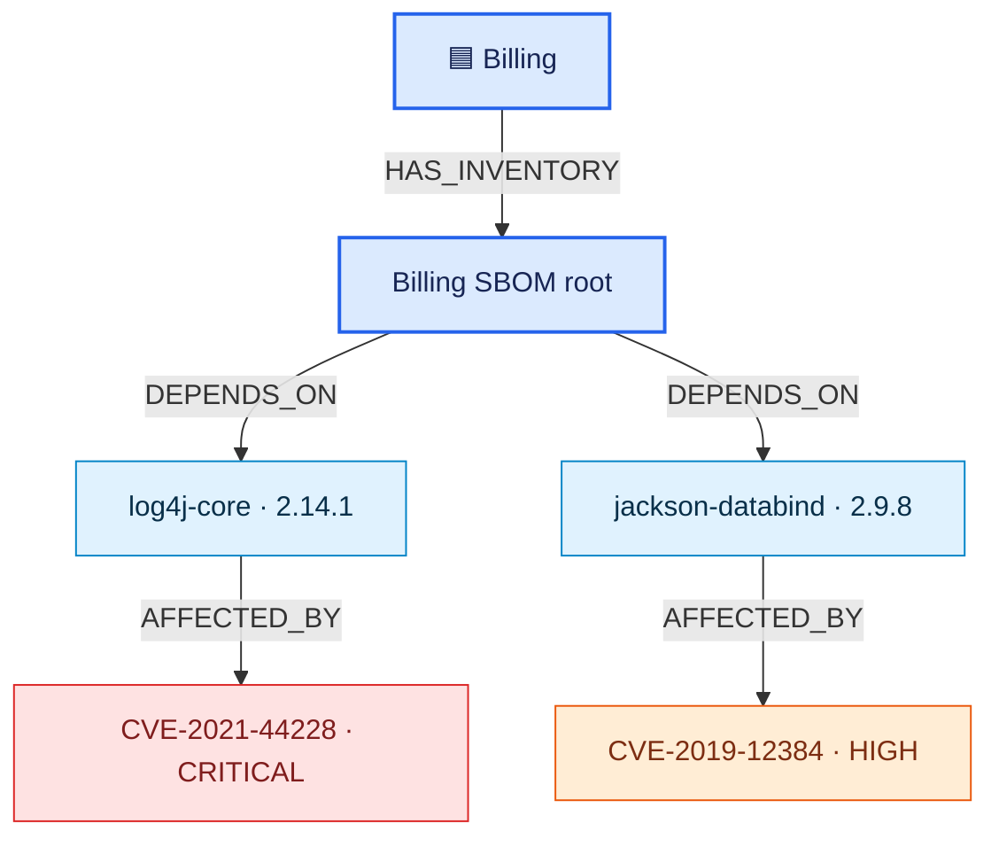
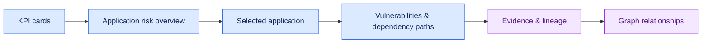

<a id="top"></a>

# Vulnerability Intelligence — Streamlit Dashboard Mockup

> **Enterprise applications · Synthetic demonstration data**  
> **Data source:** BigQuery Gold-compatible pandas DataFrames (`mart_application_overview`, `mart_application_findings`, `graph_nodes`, `graph_edges`).

This document reproduces the dashboard concept shown in our conversation, using tables, compact KPI cards, severity labels, and a visual dependency graph. Its purpose is to help the team agree on the dashboard layout before connecting it to BigQuery.

**Questions the dashboard should answer:** Which applications are affected? How seriously? Which dependencies are responsible? What evidence supports each finding?

## Contents

1. [Dashboard overview — KPI cards](#1-dashboard-overview--kpi-cards)
2. [Application risk overview](#2-application-risk-overview)
3. [Application investigation](#3-application-investigation)
4. [Vulnerability evidence and traceability](#4-vulnerability-evidence-and-traceability)
5. [Knowledge graph relationships](#5-knowledge-graph-relationships)
6. [Suggested division of dashboard work](#6-suggested-division-of-dashboard-work)
7. [Implementation sketch](#7-implementation-sketch)

---

## 1. Dashboard overview — KPI cards

### Vulnerability Intelligence

*Enterprise applications · Synthetic demonstration data* &nbsp; `MOCK GOLD`

| 📦 **Applications** | 🔎 **Affected apps** | 🛡️ **Vulnerability findings** | 🔴 **Critical apps** |
|:---:|:---:|:---:|:---:|
| **5** | **4** | **5** | **3** |

The four top-line indicators should be computed from the same filtered Gold records that feed the tables. The **five findings** here are sample application–vulnerability matches; do not assume they represent five unique CVE IDs in a production dataset.

*Dashboard component:* four `st.metric()` cards.

[↑ Back to top](#top)

---

## 2. Application risk overview

**Gold table:** `mart_application_overview`  
**Purpose:** prioritize applications by their known matched vulnerabilities.

| Application | Severity | Findings | Max CVSS |
|---|:---:|---:|---:|
| **Billing** | 🔴 **CRITICAL** | 2 | **10.0** |
| **Analytics** | 🔴 **CRITICAL** | 1 | **9.8** |
| **Customer Portal** | 🔴 **CRITICAL** | 1 | **9.8** |
| **Inventory API** | 🟠 **HIGH** | 1 | **8.3** |
| **Reporting** | ⚪ **NO KNOWN MATCH** | 0 | — |

> **Interpretation:** Three applications have critical findings. **No known match does not mean an application is secure:** it means there is no match among the advisory records and dependency versions checked.

**Suggested interaction:** selecting a row opens the application investigation below; filters can later include application, severity, component, or finding status.

[↑ Back to top](#top)

---

## 3. Application investigation

**Gold table:** `mart_application_findings`  
**Purpose:** understand which component and version generated each finding, and whether it was direct or transitive.

### Example selection: Billing

| Selected application | Findings | Affected components |
|---|---:|---:|
| **Billing** | **2** | **2** |

#### Known vulnerability findings

| Component | Installed version | Vulnerability | Severity | CVSS |
|---|---|---|:---:|---:|
| **log4j-core** | `2.14.1` | `CVE-2021-44228` | 🔴 Critical | **10.0** |
| **jackson-databind** | `2.9.8` | `CVE-2019-12384` | 🟠 High | **8.1** |

#### Dependency paths

```text
Billing
  └── billing-helper
       └── log4j-core 2.14.1
            └── AFFECTED_BY → CVE-2021-44228

Billing
  └── jackson-databind 2.9.8
       └── AFFECTED_BY → CVE-2019-12384
```

The paths should come from the SBOM dependency edges and the package/version-to-advisory match, **not** from an inferred relationship based only on names.

### Other selectable applications

| Application | Affected component | Version | Vulnerability | Severity |
|---|---|---|---|---|
| Analytics | `spring-beans` | `5.3.17` | `CVE-2022-22965` | 🔴 Critical |
| Customer Portal | `commons-text` | `1.9` | `CVE-2022-42889` | 🔴 Critical |
| Inventory API | `snakeyaml` | `1.30` | `CVE-2022-1471` | 🟠 High |
| Reporting | — | — | No known match in sample | ⚪ None |

The team can implement selection with `st.selectbox()` and display the filtered findings using `st.dataframe()`.

[↑ Back to top](#top)

---

## 4. Vulnerability evidence and traceability

**Gold table:** `mart_application_findings`  
**Purpose:** allow users to verify a finding against its source and the inventory snapshot that produced it.

### Evidence panel — Billing / Log4Shell

| Field | Sample displayed value |
|---|---|
| Vulnerability ID | `CVE-2021-44228` |
| Component | `org.apache.logging.log4j:log4j-core` |
| Installed version | `2.14.1` |
| Severity / CVSS | 🔴 Critical · `10.0` (illustrative dashboard score) |
| Published | `2021-12-10` |
| Advisory source | [OSV: CVE-2021-44228](https://osv.dev/vulnerability/CVE-2021-44228) |
| Inventory evidence | `gs://example-bronze/raw/sbom/<sha256>.json` |
| Inventory snapshot | `synthetic-sbom-01` |
| Match status | `KNOWN_VULNERABILITY` |

**Production expectation:** use the actual severity metrics returned by the sources, preserving their score system and provenance; the sample score above is for the UI mockup only. Replace placeholders with real GCS object locations and immutable source hashes. Where a field is missing or uncertain, show **unknown** rather than guessing.

**Suggested interactions:** clickable source URL, expandable evidence, SBOM snapshot identification, latest ingestion time, dependency-path inspection, and a clear indication of source freshness.

[↑ Back to top](#top)

---

## 5. Knowledge graph relationships

**Gold tables:** `graph_nodes` and `graph_edges`  
**Purpose:** make application → dependency → vulnerability relationships explicit, so they can be shown as tables today and exported to a graph service later.

### Graph edges table

| Source node | Relationship | Target node |
|---|---|---|
| Billing | `HAS_INVENTORY` | Billing SBOM root |
| Billing SBOM root | `DEPENDS_ON` | log4j-core `2.14.1` |
| log4j-core `2.14.1` | `AFFECTED_BY` | `CVE-2021-44228` |
| Billing SBOM root | `DEPENDS_ON` | jackson-databind `2.9.8` |
| jackson-databind `2.9.8` | `AFFECTED_BY` | `CVE-2019-12384` |

### Visual relationship diagram



*Diagram interpretation:* an `AFFECTED_BY` edge is a **known vulnerability match** for the named installed version; it does not, on its own, prove runtime exploitability.

### Useful graph columns

| `graph_nodes` | `graph_edges` |
|---|---|
| `node_id` (stable key) | `source_id` |
| `node_type` (application, component, vulnerability, …) | `target_id` |
| `label` | `relation` |
| `source_sha256` / optional metadata | `evidence_uri` / optional metadata |

These are the proposed display-oriented fields; when wiring the dashboard to the actual dbt views, map them to the exact columns emitted by those models.

[↑ Back to top](#top)

---

## 6. Suggested division of dashboard work

| Dashboard section | Gold source | Suggested Streamlit implementation | Priority |
|---|---|---|:---:|
| KPI cards | Application overview | `st.metric()` | **P0** |
| Application risk table | Application overview | `st.dataframe()` | **P0** |
| Application selector | Overview + findings | `st.selectbox()` | **P0** |
| Vulnerability details | Application findings | `st.dataframe()` + source links | **P0** |
| Dependency paths | Application findings | `st.expander()` / text | **P1** |
| Evidence and lineage | Application findings | Source URLs + snapshot hashes | **P1** |
| Graph relationships | Nodes + edges | Tables initially, visual graph later | **P2** |

**Recommended first milestone:** build the four KPI cards, application overview and selected-application findings. Those three views already demonstrate the central value of the pipeline. Add full provenance and graph exploration without redesigning the initial layout.

[↑ Back to top](#top)

---

## 7. Implementation sketch

Connect the existing in-memory mock generator to Streamlit. This uses the same four dataset names that our BigQuery Gold integration should provide later.

```python
import streamlit as st
from mock_gold_data import build_mock_gold

st.set_page_config(page_title="Vulnerability Intelligence", layout="wide")

# Data source adapter: replace this call with BigQuery queries later.
gold = build_mock_gold()
overview = gold["mart_application_overview"]
findings = gold["mart_application_findings"]
nodes = gold["graph_nodes"]
edges = gold["graph_edges"]

st.title("Vulnerability Intelligence")
st.caption("Enterprise applications · Synthetic demonstration data")

# Adjust column aliases to the exact schema produced by your mock generator.
name_col = "application_name"
severity_col = "severity"  # If your generator differs, map it here.

c1, c2, c3, c4 = st.columns(4)
c1.metric("Applications", len(overview))
c2.metric("Affected apps", 4)   # Replace with a filtered calculation.
c3.metric("Findings", len(findings))
c4.metric("Critical apps", 3)   # Replace with a filtered calculation.

st.subheader("Application risk overview")
st.dataframe(overview, hide_index=True, use_container_width=True)

selected = st.selectbox("Choose an application", overview[name_col].tolist())
selected_findings = findings[findings[name_col] == selected]

st.subheader(f"Findings · {selected}")
st.dataframe(selected_findings, hide_index=True, use_container_width=True)

with st.expander("Graph nodes and relationships"):
    st.dataframe(nodes, hide_index=True, use_container_width=True)
    st.dataframe(edges, hide_index=True, use_container_width=True)
```

**Note:** the metrics `4` and `3` are intentional mockup placeholders; calculate them from the dataframe's actual status/severity columns when the dashboard is implemented. Also confirm the four DataFrame schemas before hard-coding any optional field names.

### Proposed screen order



---

> **Data disclaimer:** All application names, inventories, vulnerability matches, severity summaries, graph records, and storage paths in this mockup are **synthetic demonstration data**. They are not verified security findings about real deployed applications.

[↑ Back to top](#top)
