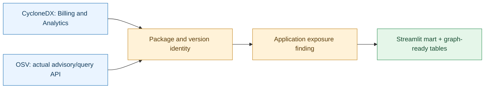
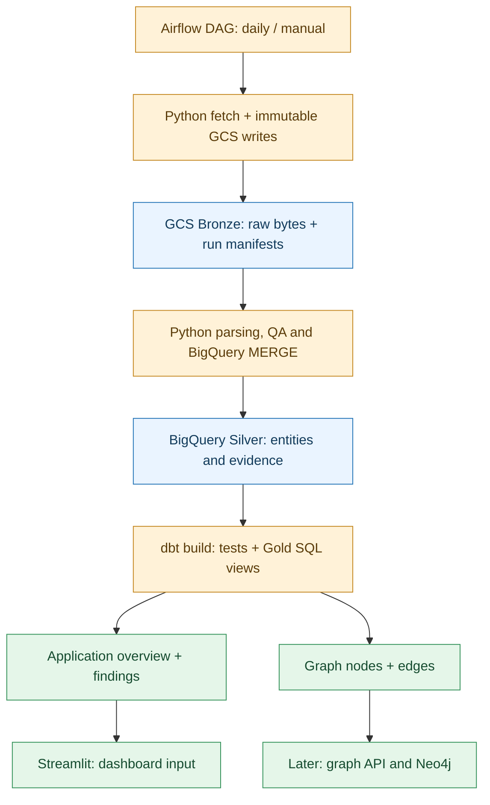
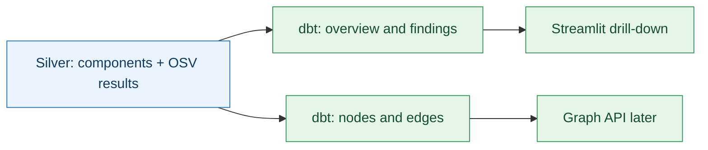

<a id="top"></a>

# From raw sources to a knowledge MVP — Airflow-first edition

**Enterprise Knowledge Intelligence Pipeline · Team implementation guide**  
**Duration:** four-day bootcamp MVP · **Execution:** Google Compute Engine VM + Docker Compose + Poetry  
**Data:** OSV advisories and CycloneDX software bills of materials (SBOMs) · **Storage:** GCS + BigQuery · **Transformations:** Python + dbt

> **Scope of this executable example.** The `Billing` and `Analytics` CycloneDX inventories in `fixtures/` are **synthetic**. The OSV API responses are **live**. The finished mart shows known vulnerability matches, not a definitive security assessment. The full companion source code is included with this guide; Cloud deployment must be executed by the team.

## Contents

1. [What the MVP will demonstrate](#1-what-the-mvp-will-demonstrate)
   - [The sources and the derived relationship](#11-the-sources-and-the-derived-relationship)
   - [Architecture and responsibilities](#12-architecture-and-responsibilities)
2. [Prepare the Google Cloud environment](#2-prepare-the-google-cloud-environment)
   - [Cloud resources and permissions](#21-cloud-resources-and-permissions)
   - [Poetry, Docker Compose and Airflow](#22-poetry-docker-compose-and-airflow)
3. [Understand the executable pipeline](#3-understand-the-executable-pipeline)
   - [Task 1: Bronze, hashing and manifests](#31-task-1-bronze-hashing-and-manifests)
   - [Task 2: QA and Silver](#32-task-2-qa-and-silver)
   - [Task 3: dbt and the Gold products](#33-task-3-dbt-and-the-gold-products)
4. [Run and validate the entire MVP](#4-run-and-validate-the-entire-mvp)
   - [Trigger the DAG and inspect BigQuery](#41-trigger-the-dag-and-inspect-bigquery)
   - [Tests, idempotency and troubleshooting](#42-tests-idempotency-and-troubleshooting)
5. [Extend the MVP without rebuilding it](#5-extend-the-mvp-without-rebuilding-it)
6. [File map and official references](#6-file-map-and-official-references)

---

## 1. What the MVP will demonstrate

### 1.1. The sources and the derived relationship

**OSV (Open Source Vulnerabilities)** identifies affected packages and versions. **CycloneDX SBOM (Software Bill of Materials)** identifies components installed in an application and their direct or transitive dependencies. A **PURL (Package URL)** identifies a package in an ecosystem such as Java/Maven.

The pipeline **creates new knowledge** when it connects an installed package and version to an OSV vulnerability and traces the dependency path back to an application.



We start with two small inventories: `Billing → billing-helper → log4j-core@2.14.1` and `Analytics → log4j-core@2.17.1`. The fixture's first dependency chain is **transitive**. The script asks OSV which precise versions are affected rather than assuming that a simplistic Python version comparison is Maven-compatible.

**MVP acceptance:** two applications appear in the overview; discovered vulnerabilities have evidence and a component path; graph tables include `HAS_INVENTORY`, `DEPENDS_ON` and `AFFECTED_BY` relationships. The UI's `NO_MATCH_IN_QUERIED_OSV` state must never be labeled “secure.”

### 1.2. Architecture and responsibilities

**Airflow replaces Cloud Scheduler, Cloud Run functions and Eventarc for orchestration.** Airflow runs in Docker Compose on our existing Google VM. The Python and dbt code stays independent of Airflow, so it can be moved to managed execution later.



| Layer | Tool | Exactly what it does |
|---|---|---|
| Orchestration | Airflow DAG | Daily schedule, task order, retries, logs and manual runs |
| Runtime | Docker Compose + Poetry | Reproducible Airflow/Python/dbt environment on the VM |
| Bronze | GCS | Original OSV JSON and CycloneDX SBOM bytes, indexed by hash; run manifests |
| Bronze metadata | BigQuery | Unique snapshot registry and ingestion-run records, without copying raw JSON |
| QA + Silver | Python + BigQuery | Validate and normalize entities; idempotent upserts via `MERGE` |
| Gold | dbt | Current application exposure overview, finding details, graph-ready views |
| Visualization | Streamlit (included) | Display known matches and expandable evidence; dependency paths are a next step |

[↑ Back to top](#top)

---

## 2. Prepare the Google Cloud environment

### 2.1. Cloud resources and permissions

On the **Google VM**, check that `gcloud`, `bq`, Docker and Docker Compose are available. Run the following commands with a GCP identity permitted to create buckets, datasets and IAM bindings:

```bash
export GCP_PROJECT="$(gcloud config get-value project)"
export BRONZE_BUCKET="${GCP_PROJECT}-knowledge-bronze"
gcloud services enable storage.googleapis.com bigquery.googleapis.com

gcloud storage buckets create "gs://${BRONZE_BUCKET}" \
  --project="${GCP_PROJECT}" --location=EU --uniform-bucket-level-access

bq --location=EU mk --dataset "${GCP_PROJECT}:vulnerability_bronze"
bq --location=EU mk --dataset "${GCP_PROJECT}:vulnerability_silver"
bq --location=EU mk --dataset "${GCP_PROJECT}:vulnerability_gold"
```

If a resource already exists, verify its location and reuse it instead of re-creating it. All three BigQuery datasets are placed in the **EU** location, consistent with the GCS bucket.

We recommend **Application Default Credentials (ADC) from the VM's attached service account**, not a downloaded JSON key. Identify the attached identity:

```bash
curl -fsS -H 'Metadata-Flavor: Google' \
  'http://metadata.google.internal/computeMetadata/v1/instance/service-accounts/default/email'

curl -fsS -H 'Metadata-Flavor: Google' \
  'http://metadata.google.internal/computeMetadata/v1/instance/service-accounts/default/scopes'
```

An administrator should grant that service account **Storage Object Admin on the specific bucket**, **BigQuery Data Editor** for the MVP datasets and **BigQuery Job User** on the project. Ensure the VM OAuth access scopes also permit BigQuery and Storage; IAM roles alone may not be sufficient on an existing VM. The reference commands are:

```bash
export VM_SA='ATTACHED_VM_SERVICE_ACCOUNT_EMAIL'

gcloud storage buckets add-iam-policy-binding "gs://${BRONZE_BUCKET}" \
  --member="serviceAccount:${VM_SA}" --role='roles/storage.objectAdmin'

gcloud projects add-iam-policy-binding "${GCP_PROJECT}" \
  --member="serviceAccount:${VM_SA}" --role='roles/bigquery.jobUser'
# For a short-lived tutorial, project-wide dataEditor is simpler;
# restrict to the three datasets for a longer-lived environment.
gcloud projects add-iam-policy-binding "${GCP_PROJECT}" \
  --member="serviceAccount:${VM_SA}" --role='roles/bigquery.dataEditor'
```

Apply the prepared table DDL from the project root:

```bash
sed "s/PROJECT_ID/${GCP_PROJECT}/g" sql/setup.sql \
  | bq query --location=EU --use_legacy_sql=false
```

> **Cost/security note.** Airflow on a persistent VM consumes resources even when no DAG is running. The bucket, BigQuery jobs and VM may incur costs. Don't expose port 8080 publicly or commit `.env`, tokens or service-account keys to Git.

### 2.2. Poetry, Docker Compose and Airflow

Copy or clone the companion project to the VM, then enter its directory. Docker and its Compose plugin should already be available from the bootcamp exercises.

```bash
cd knowledge_airflow_mvp
cp .env.example .env
# Edit the project, bucket, Airflow admin password and random secret.
code .env
chmod 600 .env

mkdir -p logs
sudo chown -R 50000:0 logs

docker compose build
docker compose up airflow-init
docker compose up -d airflow-webserver airflow-scheduler dashboard
docker compose ps
```

The Dockerfile installs **Poetry** and isolates `google-cloud-storage`, `google-cloud-bigquery` and **dbt-bigquery** in a project virtual environment. Airflow's own Python dependencies remain isolated from those tools. In `docker-compose.yml`, PostgreSQL stores **Airflow's orchestration metadata**, not our raw security data.

The Airflow UI listens on the VM's loopback address at port **8080** and the Streamlit dashboard at **8501**. Forward that port through VS Code Remote SSH, or from your Mac:

```bash
gcloud compute ssh YOUR_VM_NAME --zone=YOUR_VM_ZONE \
  -- -L 8080:localhost:8080 -L 8501:localhost:8501
# On the Mac: http://localhost:8080 and http://localhost:8501
```

The team can use the Airflow credentials configured in `.env`. The DAG is named **`knowledge_mvp`**.

[↑ Back to top](#top)

---

## 3. Understand the executable pipeline

The DAG consists of three sequential tasks. Airflow sets **two retries per task** and `max_active_runs=1` to avoid overlapping writes to the lab's temporary BigQuery staging tables.

```python
# dags/knowledge_mvp.py — essential dependency chain
fetch >> normalize >> dbt_build
```

### 3.1. Task 1: Bronze, hashing and manifests

`src/ingest.py` follows the logic of our earlier `fetch_live.py` but stores GCS objects under content-addressed names. It uploads two synthetic CycloneDX SBOMs, fetches the actual OSV Log4Shell advisory, then uses **OSV `/v1/querybatch`** to discover matches for the Maven package versions in the SBOMs.

```python
# src/ingest.py — the essential storage operation
sha = hashlib.sha256(raw_bytes).hexdigest()
object_name = f"raw/{source_name}/{sha}.json"
blob = bucket.blob(object_name)
blob.upload_from_string(raw_bytes, if_generation_match=0,
                        content_type="application/json")
```

The real script catches `PreconditionFailed`: this indicates the hash-addressed object already exists, so the run reuses it. Each DAG run also stores its own immutable manifest in `metadata/runs/` containing source URLs, SHA-256, object URIs, timestamps and the exact OSV queries. **No new raw object is needed when the response bytes are unchanged.**

```text
GCS bucket
├── raw/sbom_billing/<sha256>.json
├── raw/sbom_analytics/<sha256>.json
├── raw/osv_advisory/<sha256>.json
├── raw/osv_batch/<sha256>.json
└── metadata/runs/<run-key>.json
```

HTTP `ETag`/`If-None-Match` could later avoid transferring unchanged data at all; it is intentionally not required for this first Airflow DAG. OSV `querybatch` returns vulnerability identifiers, not complete advisory details, and the example rejects paginated results rather than silently ignoring them. Full advisory retrieval for every returned identifier is a later extension.

**Checkpoint:** explain why we have a new run manifest even when the raw object hash has not changed.

### 3.2. Task 2: QA and Silver

`src/normalize.py` downloads the exact raw objects referenced by the manifest and **recomputes their hashes**. It checks CycloneDX `bom-ref` uniqueness and `dependsOn` references, parses the source JSON and creates rows for eight Silver tables: the seven discussed in our data-model review **plus `component_findings`**, which records OSV's exact-version query results.

```python
# Essential CycloneDX quality checks in src/core.py
refs = [component.get('bom-ref') for component in components]
if any(not ref for ref in refs) or len(refs) != len(set(refs)):
    raise ValueError('Missing or duplicate bom-ref')
# Each dependency parent/child must exist in the same SBOM.
```

Each normalized row receives a stable `row_key`. The loader sends a batch to a temporary BigQuery table and merges only unseen row keys into Silver:

```sql
MERGE `PROJECT_ID.vulnerability_silver.sbom_components` T
USING `PROJECT_ID.vulnerability_silver._stage_sbom_components` S
ON T.row_key = S.row_key
WHEN NOT MATCHED THEN
  INSERT (row_key, source_sha256, bom_ref, component_name,
          component_group, component_version, package_name,
          purl, is_root)
  VALUES (S.row_key, S.source_sha256, S.bom_ref,
          S.component_name, S.component_group,
          S.component_version, S.package_name,
          S.purl, S.is_root);
```

| Tables | Important keys / relationships |
|---|---|
| `applications` | Stable `application_id`: preserves Billing's identity across future SBOM revisions |
| `sboms` | `source_sha256` + `application_id`; current inventory chosen by first-seen time |
| `sbom_components` | `source_sha256` + `bom_ref`: `bom_ref` is local to its inventory |
| `sbom_dependencies` | `source_sha256` + `parent_bom_ref` + `child_bom_ref` |
| `vulnerabilities` | Source advisory version + OSV identifier |
| `affected_packages` | Advisory snapshot + position within OSV's affected array |
| `affected_version_events` | Advisory snapshot + affected/range/event indices |
| `component_findings` | Exact `(package, version)` match returned by OSV, tied to an SBOM and query snapshot |

BigQuery Bronze **metadata** contains `source_snapshots` (WHAT was stored) and `ingestion_runs` (WHEN/HOW it was retrieved); the complete raw bytes remain in GCS. Parsing failures fail the DAG and create a diagnostic under `quarantine/reports/` without altering the original raw snapshot.

**QA scope:** JSON format, required identifiers, reference integrity and source-hash checks are included. Full CycloneDX schema validation, semantic PURL validation, canonical CVE/GHSA resolution and comprehensive Maven range interpretation are not yet implemented. OSV's exact-version API supplies the bounded matching decision for this MVP.

**Checkpoint:** why does `bom_ref='log4j'` by itself not uniquely identify a component across different SBOMs?

### 3.3. Task 3: dbt and the Gold products

`dbt build` materializes the Gold SQL **views and runs their tests**. The current-state model selects the most recently first-seen SBOM for each stable application. The output is intended for a Streamlit dashboard and later graph synchronization.

| dbt model | Intended use |
|---|---|
| `int_current_sboms` | Latest observed inventory per application |
| `mart_application_overview` | One row per application; counts and `KNOWN_VULNERABILITY` / `NO_MATCH_IN_QUERIED_OSV` flag |
| `mart_application_findings` | Components, versions, vulnerability IDs, advisory links, GCS URI and hash evidence |
| `graph_nodes` | Application, component-version and vulnerability entities |
| `graph_edges` | `HAS_INVENTORY`, `DEPENDS_ON` and `AFFECTED_BY` relationships |



The included `app.py` reads these Gold views with GCP ADC and presents an application overview and expandable findings. **Open `http://localhost:8501` over the SSH tunnel.** The initial dashboard flag indicates **known OSV matches, not severity**. The sample model uses `UNRATED` for found vulnerabilities because the MVP does not yet calculate or validate CVSS scores. A future severity-colored flag must use explicit source-derived scoring and distinguish CVSS severity from business risk.

**Checkpoint:** why must an `AFFECTED_BY` graph edge carry an SBOM hash and an OSV-query hash?

[↑ Back to top](#top)

---

## 4. Run and validate the entire MVP

### 4.1. Trigger the DAG and inspect BigQuery

After Airflow is running, enable the `knowledge_mvp` DAG and click **Trigger DAG**. Alternatively, use the Airflow CLI from the scheduler container:

```bash
docker compose exec airflow-scheduler airflow dags list

docker compose exec airflow-scheduler \
  airflow dags trigger knowledge_mvp

docker compose logs --tail=80 airflow-scheduler
```

Verify the Bronze and Gold tables after the DAG succeeds:

```bash
gcloud storage ls "gs://${BRONZE_BUCKET}/raw/" --recursive

bq query --location=EU --use_legacy_sql=false \
  "SELECT application_name, finding_count, risk_flag, severity_label
   FROM \`${GCP_PROJECT}.vulnerability_gold.mart_application_overview\`
   ORDER BY application_name"

bq query --location=EU --use_legacy_sql=false \
  "SELECT application_name, component_name, component_version,
          vulnerability_id, advisory_url, sbom_sha256
   FROM \`${GCP_PROJECT}.vulnerability_gold.mart_application_findings\`"
```

Inspect the graph exports:

```bash
bq query --location=EU --use_legacy_sql=false \
  "SELECT node_type, COUNT(*) AS n
   FROM \`${GCP_PROJECT}.vulnerability_gold.graph_nodes\`
   GROUP BY node_type"

bq query --location=EU --use_legacy_sql=false \
  "SELECT relation, COUNT(*) AS n
   FROM \`${GCP_PROJECT}.vulnerability_gold.graph_edges\`
   GROUP BY relation"
```

**Expected, not pre-verified on your VM:** `Billing` should produce a known-vulnerability finding for its Log4j 2.14.1 dependency if OSV's response still reports that case. `Analytics` using 2.17.1 should not match that **specific Log4Shell advisory**, but could match a different OSV vulnerability. Results depend on the live API response; keep that distinction in the team report.

### 4.2. Tests, idempotency and troubleshooting

Run the pure-Python tests before connecting to GCP, or from the already-built image:

```bash
# Optional on VM host, with Poetry installed:
poetry install --with dev
poetry run pytest -q

# Docker environment (no separate host Poetry needed):
docker compose exec airflow-scheduler poetry run pytest -q
```

For Cloud credentials inside Docker:

```bash
docker compose exec airflow-scheduler \
  poetry run python -c 'import google.auth; print(google.auth.default()[1])'
```

**Idempotency exercise:** trigger the same DAG again. Existing `(source, SHA-256)` GCS objects should be reused, while another manifest and `ingestion_runs` record are created. The Silver `MERGE` must not multiply rows for the same `row_key`.

```sql
SELECT row_key, COUNT(*) AS n
FROM `PROJECT_ID.vulnerability_silver.sbom_components`
GROUP BY row_key HAVING n > 1;
-- Expected: no rows
```

| Failure | First diagnosis |
|---|---|
| Permission denied on GCS or BigQuery | VM service-account IAM **and** OAuth access scopes |
| Metadata server unavailable in Docker | Test ADC from inside the scheduler container; use a supported local ADC mount only for Mac development |
| OSV request returns HTTP error | Check outbound HTTPS, response and retries in the Airflow task logs |
| DAG missing | `docker compose logs airflow-scheduler`; check Python import and path |
| dbt fails | `docker compose exec airflow-scheduler poetry run dbt debug --project-dir dbt --profiles-dir dbt_profiles` |
| BigQuery table missing | Re-run `sql/setup.sql` in the correct project and EU region |

[↑ Back to top](#top)

---

## 5. Extend the MVP without rebuilding it

This implementation is deliberately small but establishes the important contracts: immutable Bronze storage, source provenance, normalized Silver entities, dbt Gold and graph-ready outputs.

| Next iteration | Concrete adaptation |
|---|---|
| Real Java applications | Generate CycloneDX SBOMs from pinned Maven repositories, starting with OWASP WebGoat; replace `fixtures/*.json` with actual inventories |
| More complete OSV coverage | Process all `/v1/querybatch` pages where applicable; fetch complete records with `GET /v1/vulns/{id}`; maintain updated advisories |
| Severity flags | Parse CVSS vectors and scores with validated logic; add `severity_label` and business-priority rules |
| Dependency paths | Add recursive traversal to produce application → ... → vulnerable component evidence |
| Continuous inventory | Stable `application_id` registry, fresh SBOM revisions, change-detection mart and remediation history |
| Serving | Streamlit overview/drill-down; graph ingestion through the provided VPS API; explicit stale-edge deletion strategy |
| Operability | Separate staging bucket, retries/backoff, data-quality tests, API quotas, Airflow alerts and CI |

**MVP completion check:** the team can rerun the DAG, see the same source snapshots referenced by new manifests, inspect BigQuery Silver, open the Streamlit dashboard and obtain graph-ready node/edge tables. This is a meaningful end-to-end result even before Streamlit and Neo4j are connected.

[↑ Back to top](#top)

---

## 6. File map and official references

```text
knowledge_airflow_mvp/
├── docs/01_AIRFLOW_FIRST_KNOWLEDGE_MVP.md  # This guide
├── app.py                                 # Streamlit dashboard
├── docs/01_AIRFLOW_FIRST_KNOWLEDGE_MVP.pdf # Styled PDF
├── dags/knowledge_mvp.py                  # Airflow orchestration
├── src/core.py                           # Pure QA and PURL/Maven query selection
├── src/ingest.py                         # OSV/SBOM -> GCS Bronze
├── src/normalize.py                      # GCS Bronze -> BigQuery Silver
├── sql/setup.sql                         # BigQuery DDL
├── dbt/models/*.sql                      # dbt Gold models
├── dbt_profiles/profiles.yml             # dbt OAuth/ADC configuration
├── fixtures/{billing,analytics}.json     # Synthetic CycloneDX inventories
├── tests/test_core.py                     # Unit tests
├── pyproject.toml                         # Poetry dependencies
├── Dockerfile
├── docker-compose.yml
└── .env.example
```

**Official technical documentation:**

- [Apache Airflow 2.10 Docker Compose](https://airflow.apache.org/docs/apache-airflow/2.10.5/howto/docker-compose/index.html)
- [Google Cloud VM service-account authentication](https://cloud.google.com/compute/docs/access/authenticate-workloads)
- [BigQuery JSON loading](https://cloud.google.com/bigquery/docs/loading-data-cloud-storage-json)
- [dbt Core BigQuery setup](https://docs.getdbt.com/docs/local/connect-data-platform/bigquery-setup)
- [OSV batch-query API](https://google.github.io/osv.dev/post-v1-querybatch/)
- [CycloneDX SBOM examples](https://github.com/CycloneDX/bom-examples)

### Checkpoint answers

1. **A fresh manifest represents a fresh ingestion attempt.** It may reference an existing immutable raw snapshot without duplicating its content.
2. **`bom-ref` has only local SBOM scope.** Use `(source_sha256, bom_ref)` to identify a component across multiple inventories.
3. **Exposure edges are derived claims.** Keep both the inventory and advisory/query hashes so a reader can reconstruct the evidence and detect later changes.

[↑ Back to top](#top)
