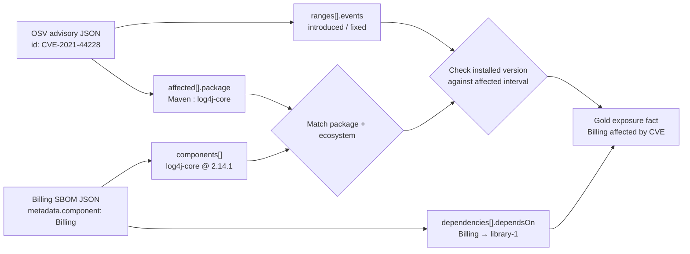
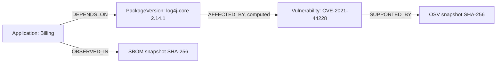

# From Data Sources to Knowledge Products — Concepts, and End-to-End Demo Pipeline


## 1. The problem without cybersecurity jargon

Imagine an organization running two applications, **Billing** and **Analytics**. Both use external libraries, just as a recipe uses ingredients. The organization has a software inventory listing the libraries and versions installed in each application. Separately, an external catalogue describes which versions of a library have a known defect. A patch is a newer version intended to fix that defect.

**Our task is to join these two independent datasets and compute which applications contain an affected library.** Neither source alone can answer that question. This is a classic Data Engineering integration problem.

| Plain-language concept | Data Engineering interpretation | Example |
|---|---|---|
| Application | Business entity / inventory owner | Billing |
| Library | Reusable software component | log4j-core |
| Installed version | Attribute of an application-component relationship | 2.14.1 |
| Known defect | External reference entity | CVE-2021-44228 |
| Affected versions | Predicate / range condition | Versions before a fixture's fixed boundary |
| Patch or upgrade | New inventory observation | Billing changes to 2.17.1 |
| Exposure | **Derived fact** created by joining and evaluating sources | Billing is affected in run 1 |

### Our demo example: Samples from the two source categories, reduced to tables

**Dataset 1 — Internal inventory**

| Application | Library | Installed version |
|---|---|---|
| Billing | log4j-core | 2.14.1 |
| Analytics | log4j-core | 2.17.1 |

**Dataset 2 — External defect catalogue**

| Defect | Library | Affected range (simplified) |
|---|---|---|
| CVE-2021-44228 | log4j-core | Introduced 2.0-beta9; fixed at 2.15.0 |

**Derived result**

| Application | Version | Affected in run 1? |
|---|---|---|
| Billing | 2.14.1 | Yes |
| Analytics | 2.17.1 | No |

The version range is a **reduced educational fixture**, not a complete description of all Log4j advisories or Maven version rules. “Not affected” here means *not matched by this one illustrated CVE/range*, not that an application is generally secure.

## 2. Why our pipeline creates knowledge independently from the AI that consumes it

A pipeline can compute new facts from existing records through **deterministic rules**: parse identifiers, match entities, compare versions, and retain evidence. The result is a **knowledge data product** — structured facts and relationships that other systems can reuse. An LLM is not necessary for this computation.

```text
Internal application inventories          External vulnerability advisories
             |                                         |
             +------------ INGEST ---------------------+
                               |
                       BRONZE snapshots
                   (original evidence + hash)
                               |
                     SILVER normalized tables
                    (identifiers + clean types)
                               |
                  MATCH + VERSION RULES
                  (deterministic transformations)
                               |
                      GOLD KNOWLEDGE MART
              /                                  \
    Streamlit dashboard                 graph-ready nodes + edges
   (SQL, history, evidence)                       |
                                          VPS graph ingestion API
                                                   |
                                              Neo4j / KG-RAG
```

**Why not write directly to Neo4j?** We could. The proposed architecture keeps a validated, queryable **Gold warehouse** independent of any one AI service. SQL/dbt are convenient for batch transformations, testing, aggregations and historical marts. Neo4j specializes in traversing connected relationships. The cost of this decoupling is the need for **reliable synchronization** between Gold and the graph. **We will discuss and validate this architectural choice as a team.**

### Why grounding an inference system is useful — separately

An LLM can formulate an answer to a question, but it does not automatically know the company's current software inventory or the provenance of each claim. A retrieval system can supply the **specific, up-to-date relationships and evidence** produced by our pipeline. A graph is particularly suitable for questions that follow chains such as `Application → LibraryVersion → Vulnerability`, especially when dependencies have multiple levels. Retrieval improves grounding; it does **not** guarantee correctness or eliminate hallucinations. The dashboard remains useful even without any LLM.

## 3. Small cybersecurity vocabulary and definitions

| Term | Nature | Meaning | Role in our pipeline |
|---|---|---|---|
| **CVE** — Common Vulnerabilities and Exposures | Identifier standard | A public vulnerability's unique reference, such as `CVE-2021-44228`. | Stable vulnerability key for joins, deduplication and reporting. |
| **OSV** — Open Source Vulnerabilities | Database, API and JSON schema | Public vulnerability records linking packages, ecosystems and affected ranges. | External source ingested and normalized in Bronze/Silver. |
| **SBOM** — Software Bill of Materials | Inventory document | Lists software components, versions and dependency links. | Internal inventory input: what applications actually contain. |
| **PURL** — Package URL | Identifier format | Structured package coordinate such as `pkg:maven/...@2.14.1`. | Helps reconcile packages from different source formats. |
| **Maven** | Java build tool and package ecosystem | Uses `groupId:artifactId` coordinates and Maven version semantics. | Defines package identity and how versions must be compared. |
| **CycloneDX** | SBOM data standard | JSON/XML specification for components and dependencies. | The format of our example inventory documents. |
| **CVSS** — Common Vulnerability Scoring System | Severity scoring system | Rates technical severity, commonly on a 0–10 scale. | Optional enrichment for dashboard prioritization. |
| **EPSS** — Exploit Prediction Scoring System | Probability model / score | Estimates exploitation probability in the next 30 days. | Optional enrichment to distinguish severity from likelihood. |
| **KEV** — Known Exploited Vulnerabilities | CISA catalogue / data feed | Lists vulnerabilities with evidence of exploitation in the wild. | Optional enrichment for prioritization and filtering. |
| **Log4j** | Java software library | Logging framework; `log4j-core` is the relevant package in our example. | Concrete library to match between advisory and SBOM. |
| **Log4Shell** | Vulnerability nickname | Name commonly used for `CVE-2021-44228`. | Our illustrative vulnerability. |
| **Node / edge** | Graph data concepts | Entity instance / directed relationship between entities. | Graph-ready export for Neo4j and retrieval. |
| **Gold / mart** | Warehouse modelling concepts | Curated tables/views designed for consumers. | Dashboard analytics, evidence, history and graph export. |

The **core demo uses CVE, OSV, SBOM, Maven and Log4j**. CVSS, EPSS and KEV can enrich a future dashboard.

## 4. Demystifying the source documents

### Source A: external advisory (OSV-shaped JSON)

```json
{
  "id": "CVE-2021-44228",
  "affected": [{
    "package": {"ecosystem": "Maven", "name": "org.apache.logging.log4j:log4j-core"},
    "ranges": [{"type": "ECOSYSTEM", "events": [
      {"introduced": "2.0-beta9"}, {"fixed": "2.15.0"}
    ]}]
  }],
  "references": [{"type": "ADVISORY", "url": "https://logging.apache.org/log4j/2.x/security.html"}]
}
```

| JSON field | Interpretation | How we use it |
|---|---|---|
| `id` | Vulnerability identifier | Unique key for the defect |
| `affected[]` | Affected package descriptions | Iterate package and range records |
| `package.ecosystem` | Package manager/ecosystem | Prevent cross-ecosystem false matches |
| `package.name` | Canonical package coordinate | Join with inventory package |
| `ranges[].type` | Range semantics | Identify version-range format |
| `events[].introduced` | Start of an affected interval | Input to version predicate |
| `events[].fixed` | End of an affected interval | Input to version predicate |
| `references[].url` | Linked supporting document | Register as a **candidate** source |

**Source A is a reduced, embedded fixture**, not the full downloaded OSV advisory. In real ingestion we must handle aliases, multiple affected ranges, special version semantics and source changes.

### Source B: internal inventory (CycloneDX-shaped JSON)

```json
{
  "bomFormat": "CycloneDX", "specVersion": "1.5",
  "metadata": {"component": {"type": "application", "name": "Billing", "bom-ref": "Billing"}},
  "components": [{
    "type": "library", "bom-ref": "library-1",
    "group": "org.apache.logging.log4j", "name": "log4j-core", "version": "2.14.1",
    "purl": "pkg:maven/org.apache.logging.log4j/log4j-core@2.14.1"
  }],
  "dependencies": [{"ref": "Billing", "dependsOn": ["library-1"]}]
}
```

| JSON field | Interpretation | How we use it |
|---|---|---|
| `bomFormat` / `specVersion` | Format declaration | Validate incoming SBOM structure |
| `metadata.component` | Application described by the inventory | Identify the root application |
| `components[]` | Software components | Normalize into inventory rows |
| `group` + `name` | Maven group and artifact | Build the package join key |
| `version` | Installed release | Compare against affected ranges |
| `purl` | Standard package coordinate | Future robust package identity mapping |
| `bom-ref` | Local document identifier | Link components to dependency records |
| `dependencies[].ref` | Parent reference | Identify the application/root |
| `dependsOn[]` | Referenced child components | Find direct dependencies |

### Before connecting JSON fields: four simple steps

The source files do **not** directly say “Billing is vulnerable.” They contain pieces of information that we combine. The following simplified illustration deliberately ignores most JSON fields so that the join is visible.

| Step | Small drawing / data | What we learn |
|---|---|---|
| **1. Inventory** | `Billing → uses → log4j-core @ 2.14.1` | A company application contains a particular library **version**. This comes from the SBOM. |
| **2. Advisory** | `CVE-2021-44228 → affects → log4j-core (versions before 2.15.0)` | An external source describes a vulnerability and a range of affected versions. |
| **3. Join and test** | `log4j-core = log4j-core` **and** `2.14.1 ∈ affected range` | We match the same package, then evaluate its installed version against the range. |
| **4. Derived fact** | `Billing → has exposure → CVE-2021-44228` | **Our pipeline creates this relationship** and stores references to both original files as evidence. |

**In simplified JSON terms**, the first file contains `application`, `library` and `version`; the second contains `vulnerability`, `library` and `affected_versions`. The common library identity connects the files, but **version matching** determines whether there is an exposure.

```text
INVENTORY JSON                           ADVISORY JSON
{                                        {
  "application": "Billing",                "vulnerability": "CVE-2021-44228",
  "library": "log4j-core",                 "library": "log4j-core",
  "version": "2.14.1"                     "fixed_before": "2.15.0"
}                                        }
            \                           /
             \   match library names   /
              +---- compare versions ---+
                          |
                          v
             DERIVED GOLD RELATIONSHIP
          Billing --EXPOSED_TO--> CVE-2021-44228
```

*The invented field `fixed_before` above is **conceptual shorthand**, not an OSV schema field. The real advisory uses `affected[].ranges[].events`, explained in Source A. The real inventory uses CycloneDX fields, explained in Source B.*

### Visual map — from actual JSON fields to related entities

The JSON documents are *containers of records*, not graph nodes themselves. We extract fields, create normalized entity keys, then compute relationships. The arrows below distinguish **source structure** from **derived knowledge**.



**How to read it:** the advisory identifies a *vulnerable package and version interval*; the SBOM identifies an *installed package and version*. The pipeline first reconciles package identities, then checks the version predicate. Only then does it create an exposure fact, retaining the original evidence from both documents.

**A second view — normalized relationships:**



The second arrow (`AFFECTED_BY`) is a **derived** relationship, not a field already present in either input. It is exactly the kind of knowledge our Gold layer produces.

### Reading the source labels and the two observations

A **source** is an input document or advisory. A **run** in this demo is a numbered *observation of the inventory state*, not a separate invocation of the Python script. One execution of `python demo_v3.py --all` simulates **both** observations, so we can compare “before upgrade” and “after upgrade” without waiting for real time to pass.

- **Run 1 — before upgrade:** Billing uses `log4j-core 2.14.1` and matches the affected range. Analytics uses `2.17.1` and does not match it.
- **Run 2 — after upgrade:** Billing now uses `2.17.1`, so the modelled exposure disappears. Analytics is unchanged.
- The **same advisory A** is consulted in both observations. The Billing inventory changes (**B1 → B2**); Analytics' inventory does not (**C1 → C2**, identical bytes and therefore identical content hash).

The script's source labels are now unambiguous:

| Source label | Meaning | Run |
|---|---|---|
| **A** | One reduced OSV advisory | Both runs |
| **B1** | Billing SBOM with version 2.14.1 | Run 1 |
| **B2** | Billing SBOM with version 2.17.1 | Run 2 |
| **C1/C2** | Analytics SBOM with version 2.17.1 | Runs 1/2; same content hash |

In the database, evidence is stored as the actual SHA-256-addressed snapshot filename, **not** these shorthand labels.

## 5. How to run and explore the five stages

Requirements: **Python 3.9+**, no third-party packages. A Poetry environment is optional because the demonstration uses only Python's standard library.

```bash
cd knowledge_pipeline_demo_v3
python3 demo_v3.py --all
```

Or execute the stages one by one, in order:

```bash
python3 demo_v3.py --step bronze
python3 demo_v3.py --step silver
python3 demo_v3.py --step gold
python3 demo_v3.py --step graph
python3 demo_v3.py --step validate
```

**Optional Poetry:** `poetry init -n`, then `poetry run python demo_v3.py --all`. Poetry is not required and no `poetry install` dependencies are needed for this standalone script. To inspect the SQLite file, install the **sqlite3 CLI** if it is not present; Python's `sqlite3` module already works without it.

### Stage 1 — Bronze: preserve the source evidence

The script serializes the illustrative source documents, computes SHA-256 hashes, saves immutable-by-convention local JSON snapshots, and writes `output/manifest.json`. The next stage reads the stored files, not the original in-memory objects. In production, GCS should preserve **actual HTTP response bytes** with ingestion metadata and object-generation/retention controls.

**Technical detail — Bronze.** We serialize each demo fixture to JSON bytes, compute `sha256(bytes)`, and write a content-addressed file. The manifest maps the logical source and observation run to its stored snapshot. A rerun with identical bytes should not produce a duplicate snapshot. In production, the ingestion client instead stores **the actual response bytes** (not reconstructed JSON), with retrieval time, source URL, status and checksum in GCS.

```python
payload = json.dumps(source_record, sort_keys=True).encode("utf-8")
digest = hashlib.sha256(payload).hexdigest()
snapshot_path = bronze_dir / f"{digest}.json"
# The downstream parser reads snapshot_path, never the original object.
```

**Validation at this stage:** check that every manifest entry points to an existing snapshot; recompute the hash and compare it with the filename; record rejected or malformed inputs rather than silently discarding them.

### Stage 2 — Silver: parse and normalize

**Technical detail — Silver.** Parse nested arrays into rows, standardize the package identity as `(ecosystem, package)`, retain the installed version separately, and attach a `source_snapshot` identifier to each observation. This is a classic **nested JSON → relational model** transformation. A simplified mapping is:

```python
for affected in advisory["affected"]:
    package = affected["package"]
    for version_range in affected["ranges"]:
        # In production, preserve every range and event, not just one.
        normalized_key = (package["ecosystem"], package["name"])
```

**Validation at this stage:** required fields present; expected data types; unique identifiers within each source/run; valid references from SBOM `dependsOn` to `bom-ref`; no accidental duplicate normalized records; source snapshot references remain resolvable.

`vulnerabilities` contains the external defect, package, range and advisory evidence. `components` contains each observed application, package, version and inventory evidence. `source_candidates` records referenced URLs, without claiming they have been verified or ingested.

| Table | Representative row | What it means |
|---|---|---|
| `vulnerabilities` | CVE-2021-44228 / Maven / log4j-core | External package defect |
| `components` | Run 1 / Billing / 2.14.1 | Inventory observation |
| `source_candidates` | Apache security page / candidate | Discovered reference for later review |

### Stage 3 — Gold: join, compare versions, preserve history

The script executes SQL joining `components` to `vulnerabilities` on **ecosystem + package**. Python evaluates the deliberately limited affected-range predicate. This is an important separation: **a matching package does not automatically imply an affected version**.

```sql
SELECT c.run_id, c.app, c.version, v.cve, v.introduced, v.fixed
FROM components AS c
JOIN vulnerabilities AS v
  ON c.ecosystem = v.ecosystem
 AND c.package = v.package;
```

**Validation of derived knowledge:** the package join must use both ecosystem and canonical package; a match must still pass the ecosystem-aware version predicate; every exposure row must reference both the advisory and inventory evidence. Compare known positive and negative test fixtures, including fixed-boundary versions. For the demo, the comparator is deliberately restricted to the tested cases.

Gold creates the `exposure` fact table plus five **consumer-oriented views**. They are **not five independent copies of the data**. They reuse the same validated facts.

| Gold table / view | Consumer | What it answers |
|---|---|---|
| `current_exposure` | **Dashboard** | What is the current application/package exposure state? |
| `dashboard_summary` | **Dashboard** | How many applications and affected matches per run? |
| `exposure_history` | **Dashboard** | What did the pipeline conclude at each observation? |
| `exposure_changes` | **Dashboard** | What changed between the two inventory runs? |
| `evidence_audit` | **Dashboard / audit** | Which original advisory and inventory snapshots support each row? |
| `exposure` | Reusable Gold fact | Shared source for dashboard and graph export |

### Five example dashboard panels

**1 — Overview** (`dashboard_summary`)

| Run | Applications | Affected application-package-CVE matches |
|---|---:|---:|
| 1 | 2 | 1 |
| 2 | 2 | 0 |

**2 — Current exposure** (`current_exposure`)

| Application | Library version | CVE | Affected by this CVE? |
|---|---|---|---|
| Analytics | 2.17.1 | CVE-2021-44228 | No |
| Billing | 2.17.1 | CVE-2021-44228 | No |

**3 — Historical observations** (`exposure_history`)

| Run | Application | Version | Affected? |
|---|---|---|---|
| 1 | Billing | 2.14.1 | Yes |
| 1 | Analytics | 2.17.1 | No |
| 2 | Billing | 2.17.1 | No |
| 2 | Analytics | 2.17.1 | No |

**4 — Changes** (`exposure_changes`)

| Application | Before | After | Interpretation |
|---|---|---|---|
| Billing | 2.14.1 / affected | 2.17.1 / not affected | Upgrade removed this modelled exposure |

**5 — Evidence explorer** (`evidence_audit`)

| Application | Advisory evidence | Inventory evidence |
|---|---|---|
| Billing | Content-hashed OSV snapshot | Content-hashed Billing SBOM |

The actual view stores full snapshot filenames, so users can open the original JSON. The dashboard's **first mission** is to make the knowledge mart observable, including changes, data quality and evidence. A practical dashboard can validate itself by reconciling the overview totals against the underlying `exposure` rows, checking that every evidence link resolves, and displaying the last successful ingestion time. Streamlit will query BigQuery Gold via its client/API in production. The demo does not implement Streamlit itself.

### Stage 4 — Graph: materialize relationships and a synchronization delta

**Node = entity instance; edge = relationship instance.** The two terms are simply the graph vocabulary for the relational concepts your classmates already know.

```text
Run 1:  (Billing) --DEPENDS_ON--> (log4j-core 2.14.1)
                                      |
                                 AFFECTED_BY
                                      v
                               (CVE-2021-44228)

Run 2:  (Billing) --DEPENDS_ON--> (log4j-core 2.17.1)
         (Analytics) --DEPENDS_ON--> (log4j-core 2.17.1)
         [No active AFFECTED_BY edge for the demo CVE]
```

The Python code derives graph nodes and edges from **Gold exposure rows**. It exports a full graph for each run and a **delta** for synchronization. This is our graph-ready data product.

| Change type | Demo delta | Reason |
|---|---:|---|
| Upsert node | 0 | Both apps, the current component and CVE already existed in run 1 |
| Delete node | 1 | Old `log4j-core@2.14.1` version no longer appears in the current graph |
| Upsert edge | 1 | Billing now depends on `log4j-core@2.17.1` |
| Delete edge | 2 | Remove Billing's old dependency and its old affected-by relation |

**Important:** This node deletion is appropriate only for the demo's **current-state graph**. A production historical graph may retain old nodes and edges with validity timestamps instead. Do not delete a shared node while other active relationships still reference it.

### Stage 5 — Validate the result

The assertions verify source hashes, affected version boundaries, the expected four exposure rows, the single changed application, discovered reference registration, evidence references and graph delta counts. **Graph reconciliation** should also check that every exported edge references existing node IDs, that a replay of the same delta is idempotent, and that the acknowledged graph state matches the current Gold export. The demo uses two simulated runs; production needs quality checks for completeness, nulls, duplicate IDs, failed runs, schema changes, lineage and incremental reconciliation.

## 6. What happens on the external VPS / VM?

The project deliberately separates resources across environments. A VPS is a **virtual machine** hosted by a provider; using one as the graph/AI serving environment is a useful approximation of a production system in which the warehouse and inference infrastructure live on different hosts, networks or generations of hardware. This introduces realistic concerns: API contracts, authentication, network failures, retries, idempotency and consistency.

These are **independent lists**, not row-by-row pairings. The VPS/VM supplies the separate serving environment; the team builds the data product and the mechanism that keeps its graph representation current.

**Provided on the VPS / VM**

| Component | Role |
|---|---|
| Prepared LLM and knowledge-graph retrieval environment | Uses retrieved relationships and evidence to help answer questions. |
| Neo4j / graph serving infrastructure | Stores graph entities and relationships for traversal. |
| Prepared retrieval and assistant services | Retrieves context and supports the question-answering interface. |
| Graph API environment/contract to integrate with | Target for the graph ingestion integration; the ingestion endpoint itself still needs implementation. |
| Host resources separate from GCP | Simulates a distinct production serving environment and its network boundary. |

**Built by the DE team**

| Deliverable | Role |
|---|---|
| GCS ingestion, Bronze/Silver/Gold pipeline | Collect, preserve, transform and publish validated data. |
| Entity resolution, version matching and quality tests | Derive trustworthy exposure facts from independent sources. |
| Gold graph-ready node/edge models | Describe the entities and relationships to export. |
| Incremental export, change detection and scheduled synchronization | Update the remote graph reliably as Gold changes. |
| Streamlit dashboard, evidence/history views and Airflow orchestration | Explore and monitor the data product; automate the workflow. |

The **graph ingestion API integration remains work to implement**. The current demonstration creates `graph_delta.json` but does not send it over the network.

### Periodic synchronization mechanism

1. Airflow schedules ingestion and transformations; only a **successful, complete** Gold batch becomes eligible for export.
2. The exporter reads stable node/edge IDs and computes changes relative to the **last acknowledged graph state** (not merely the previous scheduled run).
3. It sends idempotent **upsert** and **delete/deactivate** operations through an authenticated HTTPS FastAPI endpoint.
4. The VPS API validates the payload and applies graph mutations in Neo4j (e.g., Cypher `MERGE` for stable nodes and relationships).
5. The exporter records an acknowledgement/checkpoint and retries safely after failure; consistency checks compare Gold and graph counts/IDs.

**Example of the JSON message our exporter could send to the VPS API (a proposed interface, not an existing deployed endpoint):**

A *request contract* is an agreement between two programs about **where a message is sent, what fields it contains, and how the receiver interprets them**. Here the team would implement an exporter that sends a JSON payload over HTTPS to a FastAPI endpoint on the VPS. The endpoint would apply the requested changes to Neo4j and return a success acknowledgement. The format below is **illustrative**, so the team can still choose the endpoint URL, schema, authentication and retry behavior. `batch_id` identifies the observation; `upsert` means create-or-update; `delete` means remove or deactivate an obsolete graph item.

```json
{
  "batch_id": "run-2",
  "nodes": {"upsert": [], "delete": []},
  "edges": {
    "upsert": [{"source": "app:Billing", "type": "DEPENDS_ON", "target": "pkg:...@2.17.1"}],
    "delete": [{"source": "app:Billing", "type": "DEPENDS_ON", "target": "pkg:...@2.14.1"}]
  }
}
```

The sample abbreviates long package IDs. The actual JSON export includes full IDs and evidence fields. A robust API should also handle referential ordering (edges before node deletion), authentication, duplicate delivery, partial failures and historical retention policy.

## 7. Files, generated outputs and replay

```text
knowledge_pipeline_demo_v3/
├── demo_v3.py                      # Readable, stage-based executable script
├── Knowledge_Pipeline_End_to_End_Demo_v3.md
├── README.md
├── docker-compose.yml              # Optional PostgreSQL appendix
├── .gitignore
└── output/                         # Generated; safe to delete/rebuild
    ├── manifest.json               # Logical source -> snapshot filenames
    ├── bronze/                      # Content-addressed source JSON fixtures
    ├── demo.sqlite                  # Inspectable relational tables/views
    ├── graph_run1.json              # Initial graph
    ├── graph_run2.json              # Updated graph
    └── graph_delta.json             # Upserts and deletions to send to graph API
```

**Replay from scratch:**

```bash
python3 demo_v3.py --reset          # Deletes only generated output/
python3 demo_v3.py --all            # Rebuilds all stages and checks results
```

**Explore with SQLite CLI:**

```bash
sqlite3 -header -column output/demo.sqlite
.tables
SELECT * FROM components;
SELECT * FROM vulnerabilities;
SELECT * FROM current_exposure;
SELECT * FROM dashboard_summary;
SELECT * FROM exposure_history;
SELECT * FROM exposure_changes;
SELECT * FROM evidence_audit;
SELECT * FROM source_candidates;
.quit
```

Alternatively, use a GUI SQLite viewer or Python's built-in sqlite3 module. Unlike the earlier version, the demo **does not store only an in-memory database**; its stage outputs remain available for investigation. Running `--step silver` deliberately rebuilds the SQLite file from Bronze; rerun Gold and Graph afterwards.

## 8. Mapping the demonstration to the bootcamp project

The local Python/SQLite demo demonstrates the **data transformations**. The production-oriented stack distributes these responsibilities across tools, with explicit boundaries and testable interfaces.

| Component | Role in the project | What the local demo represents | How to validate |
|---|---|---|---|
| **Python** | HTTP/API ingestion, JSON parsing, package reconciliation, graph export | Fixture parser and staged CLI | Unit tests, schema fixtures, repeatable runs |
| **GCS** (Google Cloud Storage) | Bronze data lake: source bytes, immutable snapshots, manifests | Local `output/bronze/` and manifest | Checksums, object existence, metadata, retention rules |
| **BigQuery** | Silver and Gold warehouse tables, joins, marts, history | SQLite tables and SQL views | Row counts, uniqueness, referential and reconciliation queries |
| **dbt** | Version-controlled SQL transformations, tests, lineage and dependencies | SQL normalization and Gold views | `dbt build`, `dbt test`, source freshness where configured |
| **Airflow** | Orchestrates *all* stages: scheduling, dependencies, retries, failure handling | `--step` ordering and `--all` | DAG/task status, retries, end-to-end successful batch |
| **Docker** | Reproducible local services and packaging; optional PostgreSQL | Standalone Python by default; Docker appendix | `docker compose config`, container health checks |
| **Streamlit** | Dashboard reading Gold, not querying the LLM | Five sample dashboard views | Totals agree with Gold, evidence drill-down works |
| **FastAPI + Neo4j (VPS/VM)** | Separate graph ingestion and KG-RAG serving | `graph_run*.json` and `graph_delta.json` | Acknowledged batches, node/edge consistency, retry safety |

**Airflow is not a data-storage stage.** Its DAG coordinates ingestion → Bronze → Silver → Gold → quality gate → dashboard availability and graph export. dbt executes warehouse transformations *inside* that workflow. GCS holds raw source objects; BigQuery holds relational analytical data; Streamlit queries the resulting Gold views.

**Docker versus Poetry:** Docker reproduces runtime services and deployment environments; Poetry manages Python dependencies and environments. The demo has no third-party dependencies, so neither is required to run it. The optional PostgreSQL Docker Compose setup is for learning and does not replace BigQuery in the proposed architecture.

### Six core team missions

1. Cybersecurity data ingestion.
2. Data warehouse and incremental updates.
3. Entity resolution and version matching.
4. Knowledge analytics mart and dashboard.
5. Graph relationship construction and export.
6. Discover and register source references.

### Core mission 6 — Discover and register source references

An advisory often links to vendor bulletins, patches, research articles or other advisories. Those URLs are **not automatically new trusted data sources**. Our core mission is to extract them, deduplicate them and store a small **candidate-source registry**.

| Registry field | Example | Purpose |
|---|---|---|
| `url` | Apache Log4j security advisory URL | Candidate location |
| `discovered_from` | OSV advisory / CVE-2021-44228 | Origin and traceability |
| `first_seen` | Ingestion timestamp | History and freshness |
| `status` | `candidate` | No claim of verification or ingestion |

```text
OSV advisory → references[].url → normalize URL → deduplicate → candidate registry
                                                             |
                                               optional future qualification
                                                             |
                                               optional future ingestion
```

**Validation:** every candidate has a valid origin, repeated URLs do not create duplicate registry entries, and discovery alone never silently triggers ingestion. Automatic trust assessment and parser selection belong to the optional extensions.

The **core demo objective** is to explore the knowledge analytics mart, including changes and evidence. The **extended objective** is to use KG-RAG to explain affected inventories and supporting relationships.

### Scale and the practical enterprise question — the scale is

A real organization may have **hundreds or thousands of applications**, with many more direct and transitive library dependencies. Public vulnerability feeds contain **large, continuously changing catalogues**, so the eventual join workload can be substantial. For the four-day project we should **deliberately restrict scope**: one package ecosystem (Maven), a manageable sample of SBOMs and a bounded subset of advisories. These are planning assumptions, not measured production volumes or a commitment to process every CVE.

An IT manager might ask: **“Here is the list of software our company runs. Which applications are affected by known vulnerabilities, and have upgrades resolved them?”** We can answer this *if the list includes sufficiently precise component/package identities and versions*, ideally via SBOMs. A plain list of application names is usually insufficient to infer all embedded dependencies. **“Is everything up to date?”** is a different question: comparing installed versions to the *latest available releases* needs additional release-catalogue data and may become an extension.

## 9. What this small script proves — and what it does not

**Demonstrated locally:** a reduced advisory and synthetic SBOMs can be normalized; a package join plus bounded version rule creates a new exposure fact; two observations produce change history; Gold supports independent dashboard views and graph export; evidence is retained; and a graph synchronization delta can be computed. These are the central Data Engineering concepts.

**Not demonstrated yet:** live public-source ingestion, full OSV semantics, correct Maven ordering for all versions, enterprise-grade SBOM coverage, transitive dependencies, cloud services, actual Streamlit or Neo4j execution, or a deployed graph API. A two-run simulation is not the same as continuous incremental production processing.

**Industrial relevance:** enterprises need to connect generic vulnerability intelligence with their **own** inventories, track changes and show evidence. Existing SCA and vulnerability-management products already do parts of this; our project focuses on building a transparent, reusable knowledge data product and exploring its value for analytical and graph-grounded consumers.

## Appendix A — Optional PostgreSQL in Docker

SQLite is the **recommended default** for this demo: no server, no account and no dependencies. PostgreSQL is optional practice for the class; the supplied Python script still writes SQLite and does **not** automatically populate PostgreSQL.

The companion `docker-compose.yml` starts PostgreSQL 16 on **host port 5433** (container port 5432):

```bash
docker compose up -d
# Check container readiness
docker compose exec postgres pg_isready -U demo -d knowledge_demo
# Open psql
docker compose exec postgres psql -U demo -d knowledge_demo
```

For a practical inspection exercise, import the SQLite tables into PostgreSQL using a small migration script or CSV exports (a separate task), then run the equivalent SELECT queries. Do not confuse this optional PostgreSQL environment with the production BigQuery warehouse.

To stop the server: `docker compose down`. To **delete its database volume**, use `docker compose down -v` (destructive).

## Appendix B — Source links and reading

- OSV advisory: https://osv.dev/vulnerability/CVE-2021-44228
- OSV example JSON: https://storage.googleapis.com/cve-osv-conversion/osv-output/CVE-2021-44228.json
- Apache Log4j security advisories: https://logging.apache.org/log4j/2.x/security.html
- CycloneDX example SBOMs: https://github.com/CycloneDX/bom-examples
- Neo4j Cypher `MERGE`: https://neo4j.com/docs/cypher-manual/current/clauses/merge/


## 10. Optional extensions — to decide together

These are **options, not requirements for the four-day core**. The same Bronze → Silver → Gold pattern can serve new domains without assuming that their extraction and modelling rules are identical.

| Extension | Simple explanation | Additional work / decision |
|---|---|---|
| **Reuse for EU AI Act documents** | Ingest versioned legal HTML/XML/PDF, extract articles, paragraphs and references, then model AI systems, roles and obligations as validated knowledge. | New document parsers, semantic interpretation, curated/reviewed rules and legal provenance; reuse the pipeline backbone, not the cybersecurity version-matching rules. |
| **Automated qualification and ingestion of discovered sources** | Go beyond registering referenced URLs: evaluate relevance, authority and format, select an ingestion strategy and add accepted sources. | Source trust policy, parser development, review gates, failure handling and monitoring. |
| **Terraform provisioning** | Define cloud resources (e.g., buckets, datasets, permissions) as version-controlled infrastructure code. | Optional infrastructure-as-code exercise; decide together based on time and access. |
| **RDF inputs** | **Resource Description Framework** expresses statements as **subject–predicate–object triples**; e.g., `Billing → DEPENDS_ON → log4j-core`. | Relevant RDF datasets/ontologies can be another source category. Their structure maps naturally to our graph-ready node/edge model, but importing RDF into a Neo4j property graph still requires explicit mapping and validation. |

The pipeline reusability is and architectural decision: the ingestion, snapshotting, orchestration, testing, history and serving patterns will be reusable (cf. AI-Act Legal Corpus extension). Only domain-specific entity resolution and rules must still be engineered and validated for each use case.
