# MVP v4 — End-to-end vulnerability intelligence

**Enterprise Knowledge Intelligence Pipeline · Implementation guide · 25 November 2026**

## 1. Scope and architecture

This version reconciles the modular ingestion architecture in `fetch_v2.zip`, the eight-table Silver implementation in MVP v3 and the six proven SQLite/dbt models in `sqlite_silver_gold_mvp_v2.zip`. Bronze remains local; Silver and Gold use BigQuery. Streamlit reads the Gold marts. GCS and Airflow are outside this iteration.

```mermaid
flowchart LR
 A[5 real apps × 3 releases] --> B[Generated CycloneDX SBOMs]
 B --> C[OSV batch POST + advisory GET]
 C --> D[Bronze snapshots + manifests]
 D --> E[Offline Silver validation]
 E --> F[BigQuery transactional MERGE]
 F --> G[Shortest paths + dbt Gold]
 G --> H[Streamlit]
 classDef storage fill:#e8f0fc,stroke:#5379ad,color:#172e50;
 classDef qa fill:#e5f5ed,stroke:#27835a,color:#145338;
 class D,F storage;
 class E,G qa;
```



### Project structure

```text
mvp/
├── applications.json               # Real release registry
├── generate_sboms.py               # Separate inventory generation
├── fetch_live.py                   # Ingestion CLI
├── pipeline/ingestion/
│   ├── ingest.py                   # Run coordination
│   ├── manifest.py                 # Atomic run manifests
│   ├── storage.py                  # Raw-byte and semantic hashes
│   ├── http.py                     # Bounded HTTP retries
│   ├── osv_query.py                # Batch, pagination and evidence
│   └── providers/{sbom,osv}.py
├── component_identity.py           # Shared inventory identity rules
├── storage.py                      # Compatibility import
├── config.py                       # Dataset isolation
├── build_silver.py
├── schema_validation.py
├── load_silver_to_bigquery.py
├── sql/                            # Eight Silver DDL contracts
├── migrate_schema.py
├── migrations/001_release_provenance.sql
├── build_gold.py                   # BFS paths and dbt build
├── gold/
│   ├── dbt_project.yml
│   ├── profiles/profiles.yml
│   ├── models/                    # Six translated SQL models + sources
│   └── tests/                     # Five SQL quality tests
├── app.py                         # Adapted Streamlit dashboard
├── fixtures/snapshots/            # Synthetic Billing/Analytics only
├── tests/{test_pipeline,test_gold}.py
├── README.md, requirements.txt, .env.example, .gitignore
└── data/                          # Generated, excluded from Git and ZIP
```

The archive contains the implementation and original synthetic reference snapshots, not live assessment results or credentials. The actual historical releases must be resolved and generated on a network-enabled machine.

## 2. The real sample: five applications, three releases each

The sample targets Maven projects with command-line, server or web application use cases and varied dependency graphs. Published release histories support the selection; the exact Git tags and build compatibility must still be verified by the generation script.

| Application | Selected release versions | Real-world role |
|---|---|---|
| OWASP WebGoat | 2023.3 · 2023.4 · 2023.8 | Security-training web application |
| Checkstyle | 10.12.0 · 10.15.0 · 10.21.0 | Java source-code analysis CLI |
| Apache Maven | 3.8.8 · 3.9.6 · 3.9.9 | Build and dependency management CLI |
| Apache Tika | 2.9.0 · 2.9.1 · 2.9.2 | Document extraction toolkit, CLI/server |
| Apache PDFBox | 2.0.29 · 2.0.30 · 2.0.31 | PDF processing toolkit and CLI tools |

WebGoat is deliberately insecure; its own training vulnerabilities are not the subject of this assessment. The same third-party dependency matching policy applies to all five projects. PDFBox and Tika are assessed as source-project/tool inventories, not as a guarantee of the exact contents of a deployed binary.

### Reproducible inventory generation

`generate_sboms.py` reads the registry, resolves each tag to a real Git commit, saves `revision.json`, checks out that commit and invokes CycloneDX Maven plugin 2.9.1 (`makeAggregateBom`). It requests compile/runtime scope and excludes test, provided and system scopes. Each successful inventory has an original `bom.json`, a SHA-256-verified `bom.provenance.json` and a Maven log. The sidecar records repository, release, commit timestamp, generator command, JDK/Maven versions and generation timestamp. Existing verified inventories are reused unless `--refresh` is specified; revision locks remain pinned.

**Build safety:** generate inventories on an isolated, non-privileged build machine without cloud credentials or access to privileged instance service accounts. Historical Maven projects can execute build extensions and plugins. Do not launch old applications or WebGoat. Transfer the resulting `data/inventories/` directory to the pipeline VM if using separate machines.

Your Java 17, Maven 3.6.3 and Python 3.12.8 provide a starting toolchain. Some releases may require a newer Maven/JDK or different build settings; inspect the recorded failure and fix the build environment rather than fabricate an SBOM. The script does not claim a successful build or inventory when generation fails.

### Release time versus evaluation time

The historical comparison shows **the vulnerability exposure of historical release inventories evaluated with currently available OSV knowledge**. A commit timestamp is not necessarily the public release date. Comparing three releases can expose a dependency upgrade, but does not reconstruct what was known on their original release dates or prove exploitation.

## 3. Ingestion and Bronze

The supplied `fetch_v2` module boundaries are retained. The orchestrator no longer uses the example GitHub SBOM URLs or hard-coded Log4Shell advisory. It reads generated inventories, validates their provenance, extracts reliable Maven coordinates and deduplicates identical package/version requests across releases. Batch requests contain at most 100 queries. The exact ordered POST payload and raw response are retained; pagination is followed for each result. Four total attempts are allowed for transient HTTP errors, using bounded backoff and Retry-After when present. Excessive or repeated pagination tokens fail the query. Complete advisory records are downloaded once per discovered OSV ID per run.

```text
data/
├── inventories/<application>/<release>/
│   ├── revision.json, bom.json, bom.provenance.json
│   └── maven.log
├── worktrees/<application>/<release>/
├── raw/
│   ├── sbom_<application>/<sha256>.json
│   ├── osv_batch_requests/<sha256>.json
│   ├── osv_batch/<sha256>.json
│   ├── osv_queries/<sha256>.json
│   └── osv_advisory/<sha256>.json
├── metadata/
│   ├── generation/<run>.json
│   ├── runs/<run>.json
│   └── loads/<load>.json
└── demo/                        # Isolated synthetic run data
```

### Snapshot and manifest contract

| Evidence | Shape and grain |
|---|---|
| SBOM and full advisory | Original CycloneDX / OSV JSON bytes, one snapshot per content hash |
| Batch request | `queries[]`: exact package ecosystem, name, version and optional page token |
| Batch response | `results[]`: positional results containing vulnerability IDs and continuation tokens |
| Query evidence | Request plus ordered page descriptors, each referencing request hash, response hash and result index |
| Run manifest v3 | Run ID, mode, timestamps, status, SBOM provenance, advisories, batches, query attempts and errors |

The filename hash is always SHA-256 of the original bytes. A separate normalized JSON hash (sorted keys, compact serialization) helps recognize equivalent formatting, but is not substituted for physical identity. Hashing precedes storage, not the HTTP download itself. Identical bytes reuse a file; avoiding repeat downloads would require a separate conditional-request strategy. Snapshot publication is atomic; run manifests replace the mutable global registry, preserving a replayable history. HTTP metadata is recorded for captured responses.

The query evidence descriptor ties a successful or incomplete response back to the exact component. Silver verifies hashes, positional cardinality, request identity and complete pagination before promoting a result. A failed page retains partial evidence for investigation but never becomes a completed zero-match observation.

## 4. Silver: schema, QA and idempotency

Eight core tables are retained. `sbom_id` is the stable application ID. The `sboms` table gains eight nullable provenance fields (`release_tag`, `repository_url`, `git_commit`, `commit_at`, `java_version`, `maven_version`, `generator_version`, `generated_at`). Live ingestion requires them; fixtures may omit them. All other original Silver columns are unchanged.

| Silver table | Deterministic row key |
|---|---|
| `sboms` | Source SHA-256 |
| `sbom_components` | Source SHA-256 + component index |
| `sbom_dependencies` | Source SHA-256 + parent/child bom-ref |
| `vulnerabilities` | OSV ID + advisory SHA-256 |
| `affected_packages` | Advisory key + affected index |
| `affected_version_events` | Affected key + range/event indices |
| `component_queries` | SBOM SHA-256 + bom-ref (latest attempt) |
| `component_findings` | SBOM SHA-256 + bom-ref + vulnerability ID |

`build_silver.py` replays manifests offline and validates the input shapes, component identities, dependency references, raw hashes and DataFrame contract. Nested inventory membership is flattened without inventing edges. Maven PURLs must agree with explicit group/name/version; common `type=jar` or `type=pom` qualifiers are accepted, other ambiguous identities are skipped. SQL DDL is the single source of truth for column types and modes. UTC timestamps are normalized to microseconds. Missing required values, mismatched array types and schema drift stop the load.

`load_silver_to_bigquery.py` validates the deployed schema, stages eight DataFrames and commits a single multi-table transaction. Immutable facts use insert-only `MERGE` by row key. The two query bridge tables replace the latest observation and stale findings together; older observations cannot overwrite newer ones. Successful loads write audit records rather than local skip checkpoints. Replaying an unchanged manifest does not append duplicates. Existing duplicate target keys are rejected; use one writer per dataset. An identical SBOM hash cannot represent two distinct application/release identities in this MVP.

### Controlled migration

`migrate_schema.py` is separate from ingestion. The supplied additive migration introduces release provenance columns; it checks existing schema drift, tracks migration names and checksums in `schema_migrations`, and records success after validation. Run without `--apply` to review SQL, then use `--apply` only after review and backup. Permanent BigQuery DDL is not atomic across statements; the additive changes are retryable. The script does not backfill historical provenance, convert incompatible legacy arrays or clean duplicates. Use a fresh v4 dataset for this demonstration. Live Gold rejects legacy inventories without release provenance.

### Coverage is a data-quality requirement

| Query status | Reporting interpretation |
|---|---|
| SUCCESS + matches | Known package/version matches |
| SUCCESS + no matches | No known matches in completed OSV queries at evaluation time |
| FAILED / incomplete pages | Unknown; observed counts are lower bounds |
| SKIPPED / missing query | Not assessed; coverage incomplete |
| Missing inventory | Release not assessed; do not fabricate an overview row |

A newer failed observation removes stale findings from the current bridge and marks coverage incomplete; previous evidence remains in Bronze. A successful query with missing advisory enrichment retains the match and displays `PENDING` if no advisory is available. The detailed advisory is the latest available stored version, not necessarily the identical modification revision returned by the batch. No CVSS score is invented; severity remains unrated. OSV package/version matches are not exploitability assessments.

## 5. Gold, dashboard and practical use case

The original six SQLite/dbt model names and four dashboard-facing outputs are retained. The original recursive SQL is replaced by one deterministic breadth-first shortest-path traversal per inventory in Python, followed by a BigQuery `component_paths` work table. Each vertex is visited once; cycles terminate and alternate paths do not multiply output rows. Traversal is O(V+E) apart from sorting and path-string materialization. Unreachable components remain in the inventory and are marked `PATH_UNKNOWN` in findings. Paths are dependency evidence, not proof that code is executed.

| Model | Adaptation |
|---|---|
| `int_current_sboms` | Latest inventory per stable application and release, not per application alone |
| `int_component_paths` | Read materialized shortest paths |
| `mart_application_overview` | Release-level counts, query/path coverage, commit and evaluation times |
| `mart_application_findings` | Exact query bridge, release details, dependency path, advisory evidence |
| `graph_nodes` | Inventory-specific application/component node IDs; shared vulnerability IDs |
| `graph_edges` | Inventory, dependency and matched-vulnerability relationships |

Gold uses dbt table materializations so reruns replace derived results rather than append. Tests check coverage, release/finding grains, graph endpoints and bridge integrity. The `gold_publication` metadata table marks builds `BUILDING`, `FAILED` or `SUCCESS`; the dashboard refuses an unpublished build. This is a guard for the dashboard, not an atomic cross-model publication transaction. Run Silver and Gold serially with one writer and avoid concurrent dashboard reads during rebuilding.

The existing Streamlit overview, three metrics, finding table and graph tables are preserved. Changes are limited to the BigQuery connector, selection by inventory/release, a small release-comparison table, explicit coverage warnings and a bounded graph display (up to 2,000 nodes and 2,000 edges for the selected release). The full graph remains in BigQuery. The dashboard warns when a planned release is missing. It displays the last Gold publication and query evaluation timestamps; those dates should be inspected after partial runs.

### Real-world use case: dependency upgrade triage

A security engineering team maintains several versions of internal Java applications across production environments. It can generate SBOMs from the exact source revisions deployed and periodically refresh OSV matches. The comparison mart identifies which release inventories contain dependencies with known advisories and whether later releases reduce those matches. The team can inspect the component version, advisory and shortest dependency path before deciding which upgrade to prioritize. Incomplete coverage remains unknown, so a zero count cannot be used as a security clearance. The public applications in this MVP stand in for such an enterprise portfolio; they do not establish that any particular company deploys these releases.

### Suggested dashboard improvements for a later iteration

- A release-by-release comparison chart with separate coverage indicators, so a lower count caused by failed queries is not mistaken for improvement.
- A portfolio heatmap of known matches and unknown coverage by application and release.
- A focused shortest dependency path visualization for a selected vulnerability, rather than a dense full graph. These visualizations are suggestions only; they are not implemented in v4.

## 6. Execution and acceptance checks

Extract the ZIP into a new directory or branch. Do not overwrite the old `data/metadata/runs/` with legacy manifests. Use the four distinct datasets in `.env.example`; live, demo, Silver and Gold must not overlap.

```bash
cd mvp
python3 -m venv .venv
source .venv/bin/activate
python -m pip install -r requirements.txt
cp .env.example .env
# Edit .env if needed; use authorized ADC on the pipeline VM.
# If ADC is not configured:
gcloud auth application-default login
python -m unittest discover -s tests -v
```

### First: prove the complete pipeline using isolated fixtures

```bash
python fetch_live.py --demo
python build_silver.py --demo       # Optional local inspection
python load_silver_to_bigquery.py --demo
python build_gold.py --demo
MVP_DEMO=1 streamlit run app.py
```

The offline reference normalizes to 2 SBOMs, 5 components, 3 dependencies, 1 advisory, 1 affected entry, 2 range events, 3 queries and 1 finding. Local tests also reproduce 2 overview rows, 1 finding, 8 graph nodes and 6 graph edges. Demo commands that write BigQuery still require ADC and a network connection.

### Then: real release inventories and live assessment

On the isolated build machine, install Python/pandas, Git, Java and Apache Maven. Start with a single release, inspect its logs, then generate all fifteen. Transfer `data/inventories/` to the pipeline VM if separate.

```bash
python generate_sboms.py --application webgoat --release v2023.8
python generate_sboms.py
# On the pipeline VM after inventory generation/transfer:
python fetch_live.py --generated
python build_silver.py               # Optional local inspection
python load_silver_to_bigquery.py
python build_gold.py
MVP_DEMO=0 streamlit run app.py
```

The generator and fetcher return a nonzero exit code for partial runs. Review `data/metadata/generation/`, Maven logs and `data/metadata/runs/`. You can deliberately load partial evidence to demonstrate unknown coverage, but cannot call it a complete fifteen-release assessment. Repeat capture after resolving errors. Do not reset the old checkpoints or delete existing BigQuery tables to rerun v4.

### Verification status

| Check | Result |
|---|---|
| Python compilation | Passed |
| Offline regression suite | 14/14 passed |
| Eight-table reference normalization | Passed |
| Translated Gold logic, executed locally with SQLite-compatible relation/UNION substitutions | Passed |
| Retry, partial pagination, failed/skipped/missing coverage, multiple releases, cycle-safe traversal | Passed locally |
| Exact Git tag/commit resolution and genuine SBOM generation | Pending on build VM; network DNS blocked here |
| Live OSV and BigQuery load / migrations / dbt / Streamlit | Implemented; live verification pending |

The candidate releases are real published projects, but this archive does not include fifteen generated SBOMs or claim live vulnerability counts. Network restrictions prevented Git access and the container lacks the BigQuery/dbt runtime. Local SQL tests are not a substitute for a BigQuery execution test. The full pipeline still needs to pass on your VM. Remaining boundaries: structural rather than exhaustive official JSON Schema validation; full Bronze replay at MVP scale; no non-Maven matching, alias-level CVE deduplication, runtime reachability or automated cloud orchestration.

### Reference material

- Supplied: `fetch_v2.zip`, `sqlite_silver_gold_mvp_v2.zip`, `MVP_Ingestion_to_Silver_v3.md`, `Silver_Schema_Migration_and_Idempotency.md`, and `02_FROM_SOURCE_SELECTION_TO_REAL_APPLICATIONS.md`.
- Release histories: [WebGoat](https://github.com/WebGoat/WebGoat/releases), [Checkstyle](https://checkstyle.org/release-notes-old-8-35-10-26.html), [Maven](https://maven.apache.org/docs/history.html), [Tika](https://release-catalog.apache.org/tika/archive.html), [PDFBox](https://release-catalog.apache.org/pdfbox/archive.html).
- API/tool references: [CycloneDX Maven plugin](https://cyclonedx.github.io/cyclonedx-maven-plugin/), [OSV batch query](https://google.github.io/osv.dev/post-v1-querybatch/), [OSV advisory API](https://google.github.io/osv.dev/get-v1-vulns/).
