# MVP v4 — End-to-End Vulnerability Intelligence

The new MVP reconciles the modular ingestion architecture from your `fetch_v2.zip`, our BigQuery Silver implementation and your tested SQLite/dbt Gold implementation.

The architecture now supports historical application-release comparisons, with validation and idempotency throughout the pipeline.

## 1. Deliverables

| Deliverable | Description |
|---|---|
| [MVP v4 — Complete package (.zip)](mvp_v4.zip) | 56 files · Python · BigQuery · dbt · Streamlit · SQL migrations · Automated tests |
| [PDF — Implementation Guide](MVP_v4_End_to_End.pdf) | Styled architecture diagrams, implementation decisions, QA and execution instructions. |
| [Markdown — Implementation Guide](MVP_v4_End_to_End.md) | GitHub-ready documentation with Mermaid architecture diagram. |

| Planned real applications | Target release inventories | Local regression tests |
|---:|---:|---:|
| **5** | **15** | **14/14** |

**Important:** The implementation and offline tests are complete. The generation of the fifteen genuine SBOMs and live BigQuery execution still require your VM. Network restrictions prevented me from completing those operations here.

## 2. New architecture

```mermaid
flowchart TD
 A["Real application releases: WebGoat, Checkstyle, Apache Maven, Apache Tika, Apache PDFBox — 3 releases each"] --> B["Inventory generation: generate_sboms.py — Resolve Git tags, pin commits, generate CycloneDX inventories and record provenance"]
 B --> C["Modular ingestion: pipeline/ingestion/ — Deduplicated OSV batch queries, pagination, retries and advisory retrieval"]
 C --> D["Bronze — Local filesystem: Immutable snapshots, SHA-256 hashes, query evidence and run manifests"]
 D --> E["Silver processing: build_silver.py · schema_validation.py · load_silver_to_bigquery.py — Validate evidence, normalize schemas and persist rows using transactional MERGE operations"]
 E --> F["Silver — BigQuery: sboms, sbom_components, sbom_dependencies, vulnerabilities, affected_packages, affected_version_events, component_queries, component_findings"]
 F --> G["Gold processing: build_gold.py · dbt — Cycle-safe shortest dependency paths, release comparisons, business transformations and quality tests"]
 G --> H["Gold — BigQuery: mart_application_overview, mart_application_findings, graph_nodes, graph_edges"]
 H --> I["Streamlit dashboard — Application and release comparison, vulnerability evidence and dependency graphs"]
 classDef storage fill:#e8f0fc,stroke:#5379ad,color:#172e50;
 classDef silver fill:#e5f5ed,stroke:#27835a,color:#145338;
 class A,D,H storage;
 class F silver;
```



No external vulnerability API calls take place after Bronze ingestion.

## 3. Selected real applications

| Application | Three historical releases |
|---|---|
| OWASP WebGoat | 2023.3 · 2023.4 · 2023.8 |
| Checkstyle | 10.12.0 · 10.15.0 · 10.21.0 |
| Apache Maven | 3.8.8 · 3.9.6 · 3.9.9 |
| Apache Tika | 2.9.0 · 2.9.1 · 2.9.2 |
| Apache PDFBox | 2.0.29 · 2.0.30 · 2.0.31 |

These projects represent different application purposes and dependency profiles. Their published release histories support the selection. Exact Git references and build compatibility remain to be verified during generation.

Billing and Analytics remain exclusively in the synthetic test fixtures.

## 4. New directory structure

```text
mvp/
├── applications.json
├── generate_sboms.py
├── fetch_live.py
├── pipeline/
│   └── ingestion/
│       ├── ingest.py
│       ├── manifest.py
│       ├── storage.py
│       ├── http.py
│       ├── osv_query.py
│       └── providers/
│           ├── sbom.py
│           └── osv.py
│
├── component_identity.py
├── storage.py
├── config.py
├── build_silver.py
├── schema_validation.py
├── load_silver_to_bigquery.py
│
├── sql/
│   ├── 01_sboms.sql
│   ├── 02_sbom_components.sql
│   ├── 03_sbom_dependencies.sql
│   ├── 04_vulnerabilities.sql
│   ├── 05_affected_packages.sql
│   ├── 06_affected_version_events.sql
│   ├── 07_component_queries.sql
│   └── 08_component_findings.sql
│
├── migrate_schema.py
├── migrations/
│   └── 001_release_provenance.sql
│
├── build_gold.py
├── gold/
│   ├── dbt_project.yml
│   ├── profiles/
│   │   └── profiles.yml
│   ├── models/
│   │   ├── sources.yml
│   │   ├── int_current_sboms.sql
│   │   ├── int_component_paths.sql
│   │   ├── mart_application_overview.sql
│   │   ├── mart_application_findings.sql
│   │   ├── graph_nodes.sql
│   │   └── graph_edges.sql
│   └── tests/
│
├── app.py
├── fixtures/
├── tests/
├── requirements.txt
├── .env.example
├── .gitignore
├── README.md
└── data/                       # Generated
```

## 5. Main engineering improvements

| Responsibility | Implementation |
|---|---|
| SBOM generation | Pinned Git revisions and recorded toolchain provenance |
| Ingestion | Original modular architecture, improved with batching, pagination and retries |
| Bronze idempotency | Content-addressed immutable snapshots |
| Silver idempotency | Deterministic row keys and transactional `MERGE` |
| Gold idempotency | Repeatable dbt table materializations |
| Dependency traversal | Breadth-first search instead of enumerating recursive paths |
| Schema validation | Raw JSON, DataFrames and deployed BigQuery schemas |
| Schema migration | Separate versioned migrations with checksum tracking |
| Gold QA | Coverage, uniqueness, query lineage and graph integrity tests |
| Dashboard | BigQuery connector, release selection and coverage warnings |

The dashboard also checks whether the latest Gold build completed successfully before presenting its results.

### Query coverage guarantee

| OSV outcome | Reporting interpretation |
|---|---|
| Successful with matches | Known vulnerabilities |
| Successful without matches | No known OSV matches at evaluation time |
| Failed request | Unknown |
| Incomplete pagination | Incomplete assessment |
| Missing package identity | Not assessed |
| Missing SBOM | Release not assessed |

A reduction in vulnerability counts caused by failed queries must never be interpreted as an improvement.

## 6. Real-world anchorage — five-line summary

A security engineering team maintains several releases of enterprise Java applications across its production environments.\
Our pipeline reconstructs their dependency inventories and periodically evaluates them against OSV.\
The comparison identifies which application releases contain known vulnerable dependencies.\
Engineers can inspect the affected component, advisory and dependency path to prioritize upgrades.\
Every finding remains traceable to source evidence, while incomplete assessments are explicitly reported as unknown.

## 7. Future dashboard suggestions

These are documented proposals, not modifications included in the current dashboard.

### Historical release comparison

*Illustrative data only — not actual vulnerability findings.*

| Release | Known vulnerability matches | Coverage |
|---|---:|---:|
| Release 1 | 24 | 100% |
| Release 2 | 15 | 100% |
| Release 3 | 7 | 100% |

### Application portfolio heatmap

*Illustrative comparison of known match counts and unknown coverage.*

| Application | R1 | R2 | R3 |
|---|---:|---:|---:|
| WebGoat | 24 | 15 | 7 |
| Checkstyle | 5 | 3 | 2 |
| Maven | 12 | 7 | 3 |
| Tika | 19 | 14 | 8 |
| PDFBox | 8 | 5 | ? |

? = incomplete or unknown assessment.

A focused dependency-path visualization would also be more useful than displaying thousands of interconnected nodes simultaneously.

## 8. Execution on your VM

### A. Environment

Extract the package into a new directory or branch. I recommend retaining your previous MVP and using fresh BigQuery datasets.

```bash
cd mvp

python3 -m venv .venv
source .venv/bin/activate
pip install -r requirements.txt

cp .env.example .env
```

Your GCP project is already configured in `.env.example`:

```dotenv
GCP_PROJECT_ID=ent-knowledge-intel-pipeline
BQ_DATASET=silver_v4
BQ_GOLD_DATASET=gold_v4
BQ_DEMO_DATASET=silver_v4_demo
BQ_DEMO_GOLD_DATASET=gold_v4_demo
BQ_LOCATION=EU
MVP_DEMO=0
```

### B. Test the complete pipeline with fixtures

```bash
python -m unittest discover -s tests -v

python fetch_live.py --demo
python build_silver.py --demo
python load_silver_to_bigquery.py --demo
python build_gold.py --demo

MVP_DEMO=1 streamlit run app.py
```

### C. Generate genuine SBOMs

Use an isolated build environment without privileged cloud credentials, since Maven projects can execute repository-controlled plugins.

Start with one release:

```bash
python generate_sboms.py \
  --application webgoat \
  --release v2023.8
```

Once successful, generate the complete sample:

```bash
python generate_sboms.py
```

Existing verified inventories are reused.

### D. Execute the live pipeline

After generating or transferring the inventories to your pipeline VM:

```bash
python fetch_live.py --generated
python load_silver_to_bigquery.py
python build_gold.py

MVP_DEMO=0 streamlit run app.py
```

## 9. Verification results and remaining limitations

**Local regression suite: 14/14 passed.**

| Entity | Count |
|---|---:|
| SBOMs | 2 |
| SBOM components | 5 |
| SBOM dependencies | 3 |
| Vulnerabilities | 1 |
| Affected packages | 1 |
| Version events | 2 |
| Component queries | 3 |
| Component findings | 1 |
| Gold overview rows | 2 |
| Gold findings | 1 |
| Graph nodes | 8 |
| Graph edges | 6 |

*Actual local test results using your original synthetic reference fixtures.*

The translated Gold logic passed local SQL regression tests using SQLite-compatible substitutions. This verifies transformation semantics but does not replace actual BigQuery execution.

The remaining limitations are genuine SBOM generation, live OSV calls, BigQuery transaction and migration testing, and live dbt/dashboard integration. Your installed Java and Maven versions are a suitable starting point, but some selected releases may require toolchain adjustments.

**I recommend executing section B first.** This isolates any BigQuery/dbt integration issues before introducing the complexity of fifteen real application inventories.
